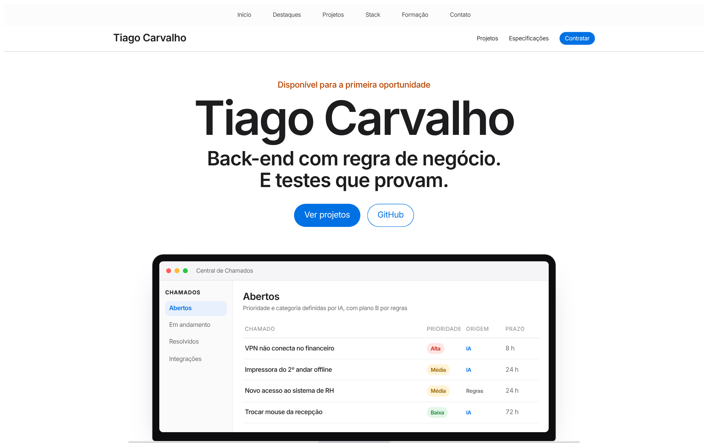
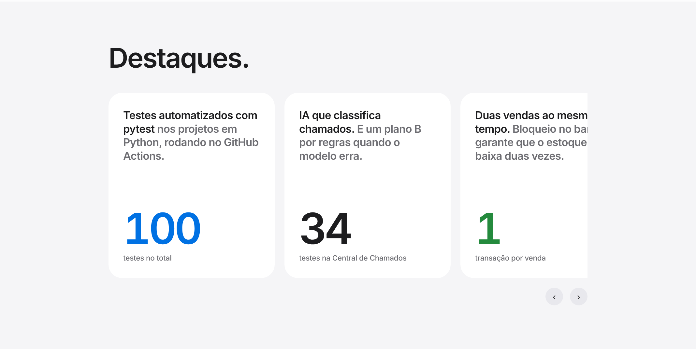
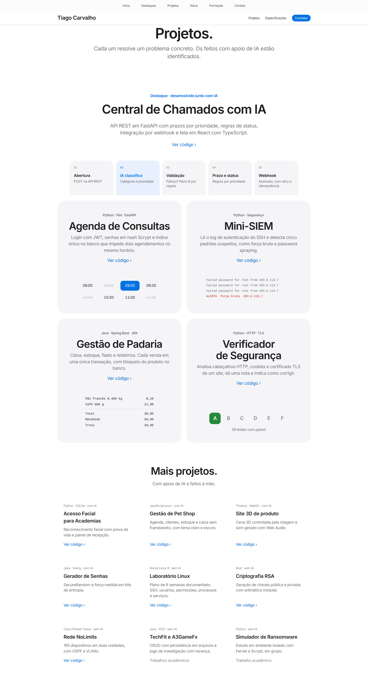
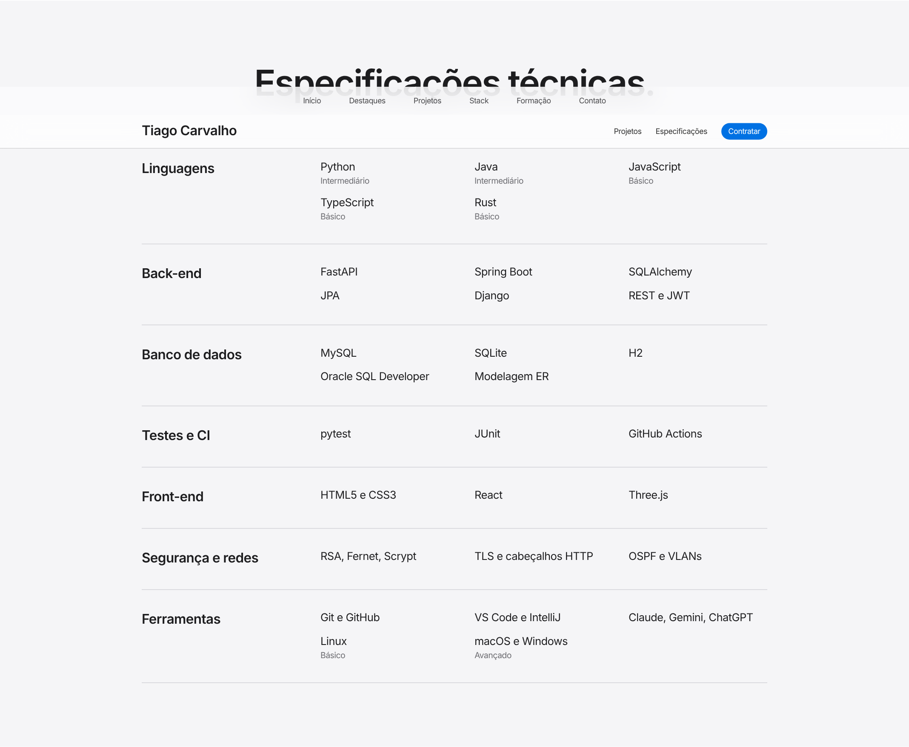
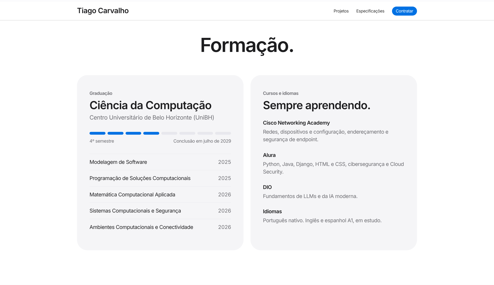
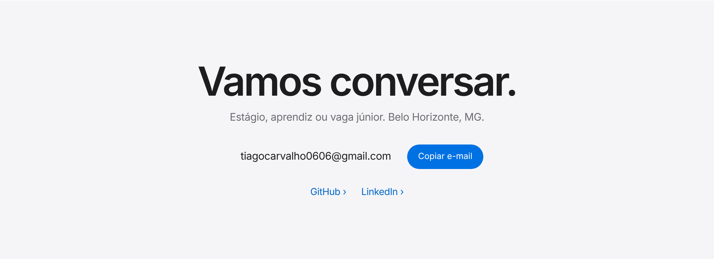
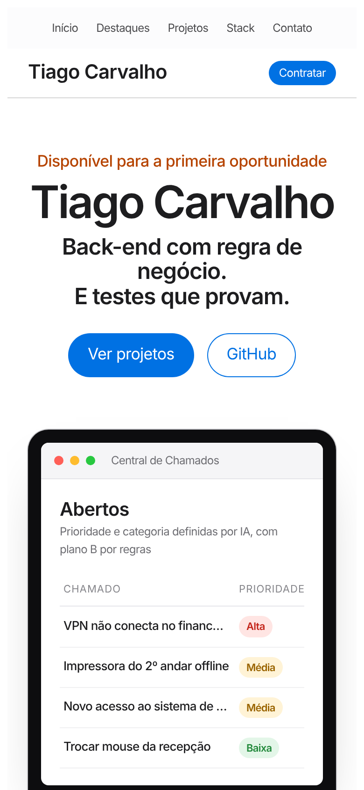

# Tiago Carvalho · Portfólio

Portfólio pessoal de **Tiago Carvalho**, estudante de Ciência da Computação no UniBH e desenvolvedor back-end (Python e Java).

**Acesse:** [dv-tiagocarvalho.github.io/Dv-TiagoCarvalho.Portfolio](https://dv-tiagocarvalho.github.io/Dv-TiagoCarvalho.Portfolio/)

## Sobre o site

Página única em HTML e CSS, sem frameworks, com design inspirado nas páginas de produto da Apple. É responsiva, funciona no celular e é publicada pelo GitHub Pages.

## Seções

### Destaques
Os principais números dos projetos, em um carrossel.

### Projetos
Central de Chamados com IA em destaque, seguida dos outros projetos. Os que tiveram apoio de IA no desenvolvimento estão identificados.

### Especificações técnicas
Linguagens, frameworks, bancos de dados, testes e ferramentas.

### Formação
Graduação em Ciência da Computação, cursos e idiomas.

### Contato

## No celular

## Contato

- E-mail: tiagocarvalho0606@gmail.com
- GitHub: [Dv-TiagoCarvalho](https://github.com/Dv-TiagoCarvalho)
- LinkedIn: [tiago-carvalho-31065a368](https://linkedin.com/in/tiago-carvalho-31065a368)
